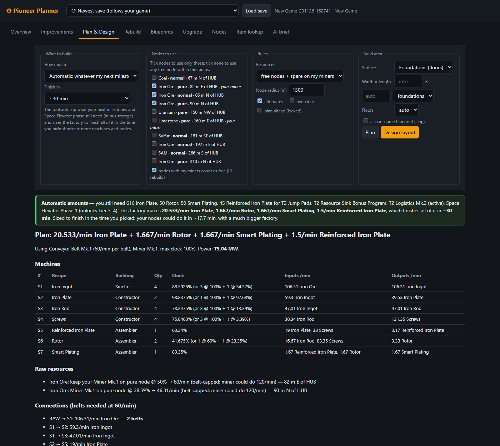
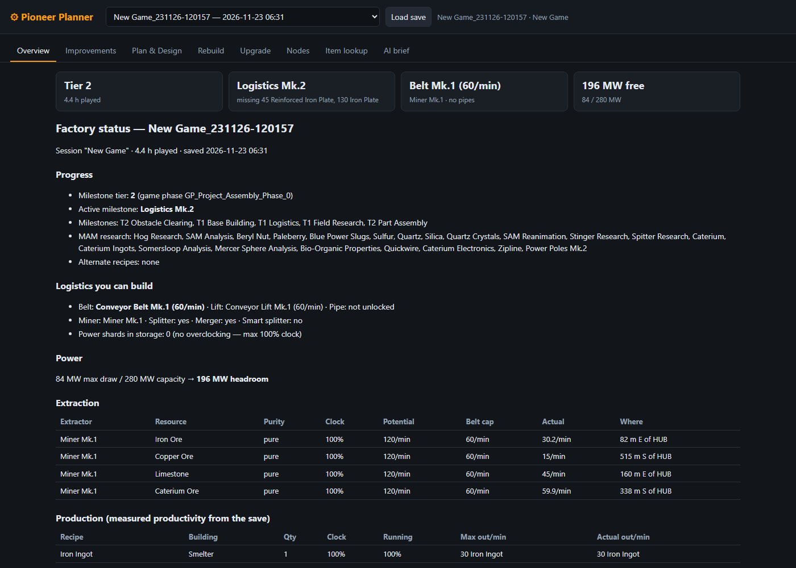
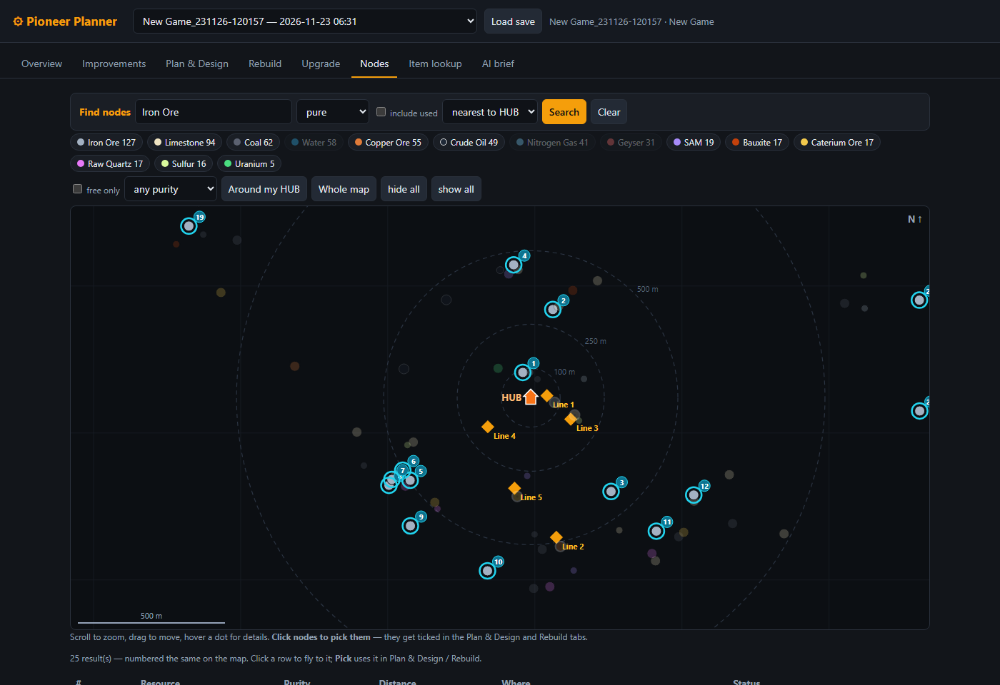
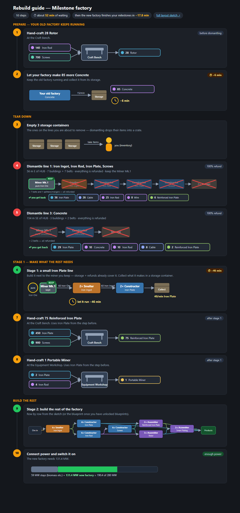
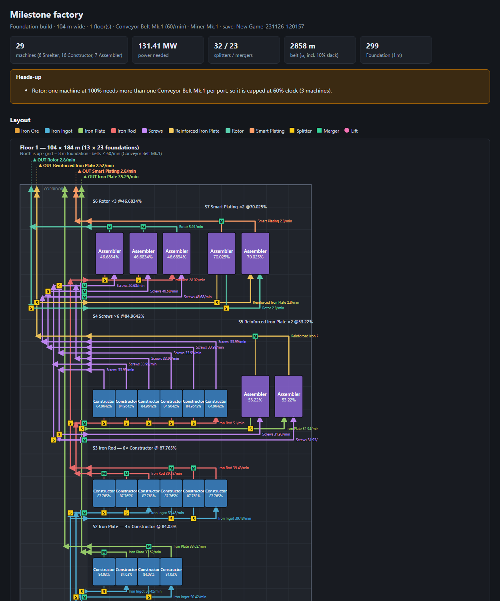
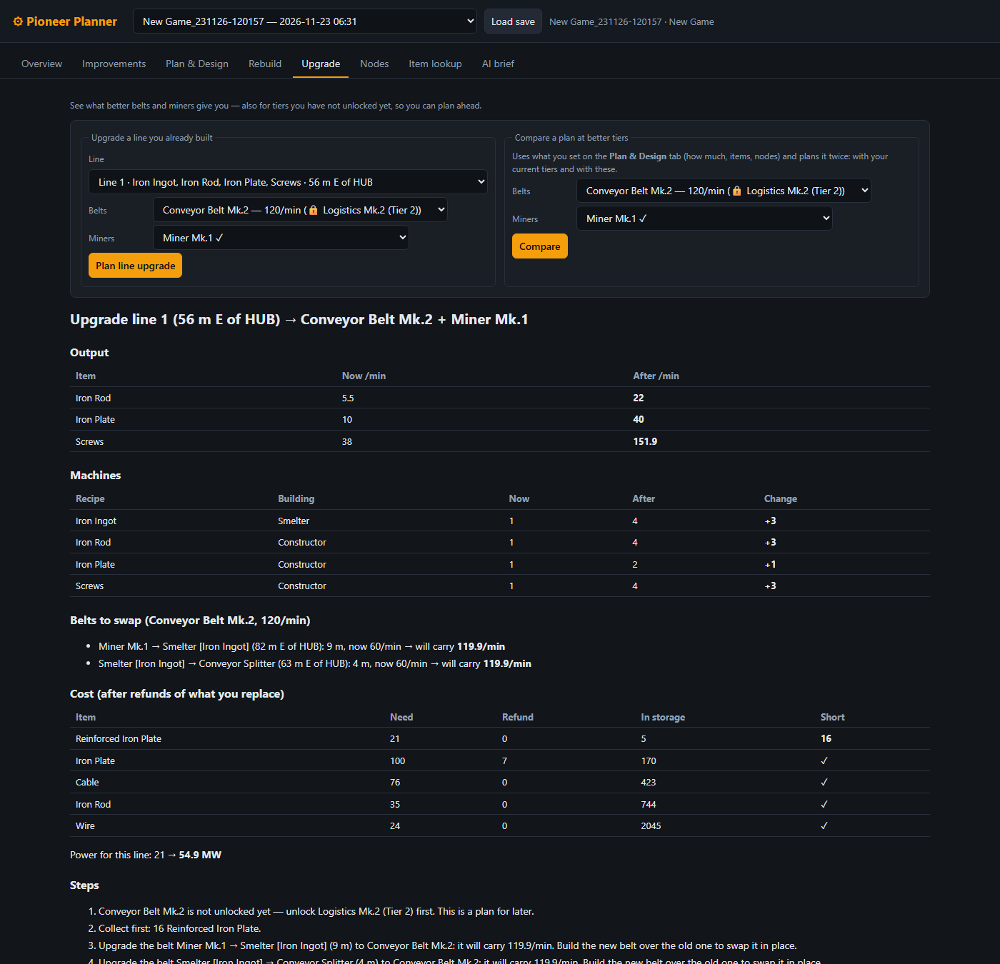
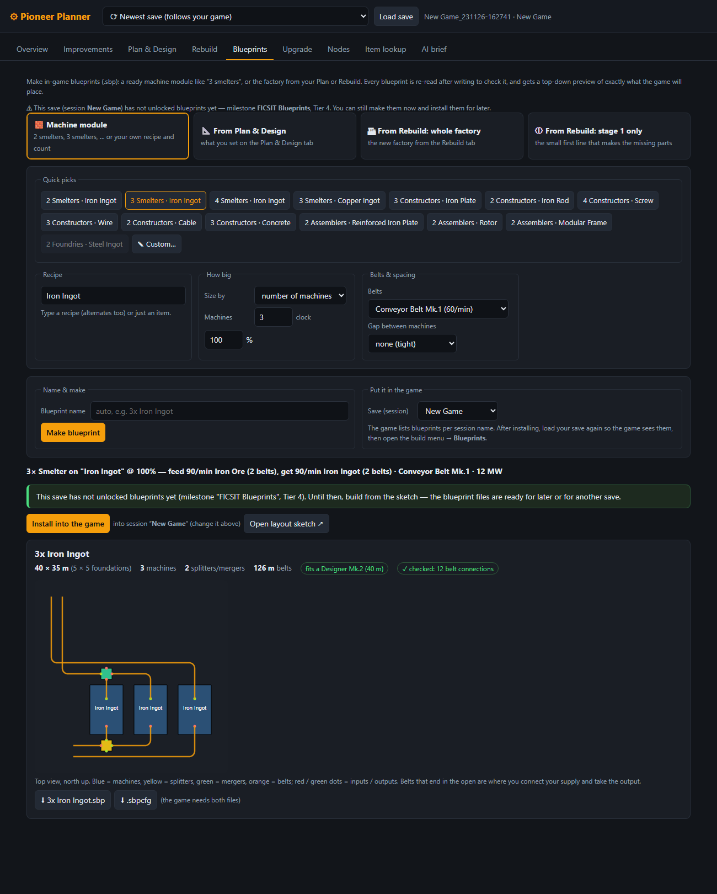

# Pioneer Planner

**A save-aware factory planner for Satisfactory.** It reads your save, plans with *your* unlocks, belts and nodes, draws build sketches, step-by-step rebuild guides and in-game blueprints. Works on its own (web UI / command line) or with Claude or any MCP-capable AI.

> Fan project, not affiliated with or endorsed by Coffee Stain Studios. Satisfactory is a trademark of Coffee Stain Studios.



## Screenshots

| | |
|---|---|
| **Your factory at a glance.** Tier, active milestone, belts, power, every miner and machine, all read from your save.  | **Node map + search.** Every node from your save, sized by purity; results are numbered on the map, and you click to pick nodes for planning.  |
| **Visual rebuild guide.** Craft first, then dismantle (100% refund), build a small stage 1 and let it run, then the rest.  | **Layout sketch.** Machine rows with splitter/merger manifolds, a belt corridor, and every belt within your belt tier.  |
| **Upgrade planner.** What a line becomes with Mk.2 belts or miners: extra output, machines to add, exact belts to swap, and the cost after refunds.  | **Blueprints.** Pick “3 smelters” (or any recipe, count or output rate) and get a checked in-game blueprint with a preview, ready to install.  |

It's a local tool that reads **your own save file**. It knows exactly what you have unlocked, where your miners are, which free nodes exist (with purity), and how your belts are connected. It then:

- **Scans your factory** and finds what's wrong, with concrete fixes. Examples: belt-capped miners, starved or backed-up machines (and *why*), unconnected outputs, full storage, low fuel, power headroom, and what you're still missing for your active milestone.
- **Plans production** using only the recipes and buildings you've unlocked, the real nodes around you, and your best belt. On Mk.1 belts it never plans more than 60/min on a belt.
- **Draws a buildable sketch**: machine rows with splitter and merger manifolds, a belt corridor routing every connection, lifts between floors, foundation counts, materials versus what's in your storage, and a step-by-step build order. Pick a foundation build (multi-floor) or plain ground, and give width × length.

It works three ways:

| Mode | How |
|---|---|
| **With Claude (or any MCP AI)** | MCP server: the AI scans your save, suggests improvements, asks what you want, plans, and hands over the sketch |
| **Web UI, no AI** | double-click **Pioneer Planner** (Desktop shortcut), or `npm run web` → http://localhost:5178 |
| **Command line** | `node bin/sfp.js …` |

All data comes from your machine:
- Recipes, buildings, belt speeds, and milestones come from the game's own `CommunityResources/Docs/en-US.json`, so numbers always match your game version.
- Your progress, factory, and resource nodes come from the `.sav` file.

## Privacy & safety

- **Nothing leaves your PC.** The tool makes no network requests: no telemetry, no accounts, no uploads.
- It only **reads** your saves and the game's Docs file. It only **writes** inside its own `output/` and `cache/` folders. The one exception is blueprint install (`--install`), which copies `.sbp` files into the game's blueprint folder, and only when you ask.
- The web UI listens on `127.0.0.1` only. It refuses requests from other websites and only loads saves from your save folders. Its *Install into the game* button only copies blueprints the planner made (from `output/`) into an existing blueprint folder or your save's session folder, and never overwrites a blueprint.
- `output/` (your sketches) and `cache/` (data derived from your game install and saves) are git-ignored and should never be published. The shipped `data/` files contain only building geometry: no names, account IDs or save names.

---

## Install (no tech needed, Windows)

1. **Install Node.js** (free) from [nodejs.org](https://nodejs.org/en/download): pick the **LTS** version and keep the default options. This is the only thing you install.
2. **Download Pioneer Planner:** on this page, click the green **Code** button → **Download ZIP**. Right-click the ZIP → **Properties** → tick **Unblock** → OK, then extract it, e.g. to `Documents\pioneer-planner`.
3. **Double-click `Pioneer Planner.cmd`** in that folder.
   - The first time, it downloads what it needs (about a minute) and asks whether to add **Pioneer Planner** to your Desktop and Start menu. Say yes.
   - It opens in its own window.

**After that:** just click **Pioneer Planner** on your Desktop.
- It always shows your **newest save**, so save in-game and press **F5** in the planner to refresh.
- It runs quietly in the background and stops when you log off or shut down. To stop it earlier, use Start menu → **Stop Pioneer Planner**.
- After an update (new ZIP or `git pull`), clicking it restarts the planner on the new version by itself.
- If Windows shows "Windows protected your PC" the first time, click **More info → Run anyway**. This is normal for scripts downloaded from the internet, and the scripts in `launcher/` are short and readable.

Requires the game installed (Steam or Epic, found automatically).

### Developer setup

```powershell
git clone https://github.com/giridharpandurangi/pioneer-planner.git
cd pioneer-planner
npm install
npm test
npm run web
```

Saves are found automatically in `%LOCALAPPDATA%\FactoryGame\Saved\SaveGames\<id>\`. The newest save is used (it follows new saves automatically) unless you pick a specific one.
If the game or saves are somewhere unusual, create `sfp.config.json`:

```json
{ "gameDir": "D:/SteamLibrary/steamapps/common/Satisfactory", "saveDir": "C:/path/to/SaveGames/<your id>" }
```

## Use with Claude

Replace `C:\path\to\pioneer-planner` below with the folder you cloned into.

**Claude Code**:

```powershell
claude mcp add pioneer-planner -- node C:\path\to\pioneer-planner\src\mcp\server.js
```

Or copy `mcp.example.json` to `.mcp.json` in the project folder, fix the path, and approve the server when Claude Code asks.

**Claude Desktop (chat)**: open **Settings → Developer → Edit Config**, add this, then fully quit and reopen Claude:

```json
{
  "mcpServers": {
    "pioneer-planner": { "command": "node", "args": ["C:\\path\\to\\pioneer-planner\\src\\mcp\\server.js"] }
  }
}
```

Then just talk to it, e.g.:
- "Review my factory" (or use the **review_factory** prompt). It loads your newest save, tells you where you stand, lists the top fixes, and asks what you want to build next.
- "I need 5 reinforced iron plates a minute, 8×12 foundations, 2 floors max" (or the **design_build** prompt)
- "What's the closest free pure coal node?"
- "Plan ahead: what would 1 computer/min need?" (it lists what you'd have to unlock)

- "My base is temporary, I want to rebuild it with the 3 iron nodes near the HUB" (or the **rebuild_base** prompt)

- "Make me a blueprint of 3 smelters on iron ingots" / "a blueprint for 60 screws a minute"

**Tools the AI gets:** `list_saves`, `load_save`, `factory_status`, `suggest_improvements`, `get_unlocks`, `find_nodes`, `item_info`, `plan_production`, `design_factory`, `milestone_needs`, `plan_rebuild`, `make_blueprint`, `list_lines`, `upgrade_line`, `compare_upgrade`, `upgrade_options`, `export_context`.

## Rebuild planner (replacing temporary builds)

Use it when you want to tear down what you have and build something better, without getting stuck halfway because you ran out of materials. CLI: `node bin/sfp.js rebuild --nearest 3 --node-res "Iron Ore"`. Web: the **Rebuild** tab. AI: `plan_rebuild`.

1. **Pick nodes.** Tick them in the web UI, pass `--nodes` / `--nearest`, or let the AI ask you. Nodes that already have a miner count as fully free, and the miner is kept.
2. **Pick a goal.** By default it builds for *everything your next milestones and the next Space Elevator phase still need* (minus what's in storage), sized to finish in about 30 minutes (pick 15 min to 2 hours, or as fast as the nodes allow). Or give your own targets.
3. **It checks the money.** The new build's cost (machines, splitters, mergers, foundations, poles, new miners, belts at ~1 unit per 2 m) is compared with your storage plus what dismantling the old lines refunds (100%), including items sitting in machine buffers.
4. **It covers every shortage** with the fastest option:
   - wait for your current factory;
   - hand-craft at the Craft Bench or Equipment Workshop;
   - or build a small, affordable **stage 1** of the new factory on the miner you keep, and let it produce the rest.
5. **It gives the order of work:** what to craft *before* touching anything, when it's safe to dismantle (it never says "dismantle" while something is still short), stage 1, then the rest.

By default it only tears down lines within 250 m of the HUB, and never lines that feed your generators.

The order of work also comes as a **visual guide** (`rebuild-guide.html` next to the sketch, and at the top of the web UI's Rebuild tab). It has one card per step, each with a small diagram and a time badge:
- **Hand-craft:** ingredients → Craft Bench → result.
- **Wait:** the old line → storage → "~15 min".
- **Dismantle:** the line crossed out, the kept miner marked KEEP, and what you get back.
- **Stage 1:** only that small build, with "let it run ~40 min".
- **Stage 2:** the whole factory as a chain of steps.
- **Power:** a meter.

`node bin/sfp.js needs` shows what your milestones still need. `node bin/sfp.js upgrades` shows, for each existing miner, what it would deliver now, with the next belt, and with the next miner. Each entry says how many machines to add and what the belt swap costs.

## Upgrade planner (better belts / miners)

Works for tiers you haven't unlocked yet, so you can plan ahead. Web: the **Upgrade** tab. CLI: `lines`, `upgrade-line`, `compare`. AI: `list_lines`, `upgrade_line`, `compare_upgrade`.

- **Upgrade a line you already built:** `node bin/sfp.js upgrade-line 1 --belt 2 --miner 2`. It keeps the line's product mix and scales it to what the better miners and belts deliver. It shows the new output and machines to add, plus which exact belts and miners to swap (with lengths and locations). The cost is net of what the replaced parts refund, compared with your storage, followed by the steps.
- **Compare a plan at better tiers:** `node bin/sfp.js compare --goal milestones --nearest 3 --node-res "Iron Ore" --rebuild --to-belt 2`. It plans the same goal twice, side by side: time to finish, output, and machines. The upgrade path says which connections need upgraded belts (and how many) and which machines to add to existing rows.

## In-game blueprints (.sbp)

The web UI's **Blueprints** tab makes them from four sources:

| Source | What you get |
|---|---|
| **Machine module** | Quick picks like *2 Smelters · Iron Ingot*, *3 Smelters*, *4 Constructors · Screw*, *2 Assemblers · Rotor*, or **custom**: any recipe (alternates too) by number of machines + clock, or by output per minute (fewest machines, evenly underclocked). Choose the belt tier and the gap between machines. |
| **From Plan & Design** | the factory you set up on the Plan & Design tab (one blueprint per floor) |
| **From Rebuild: whole factory** | the new factory from the Rebuild tab |
| **From Rebuild: stage 1 only** | just the small first line the rebuild guide tells you to build first |

Each blueprint contains:
- machines with their recipe and clock speed already set;
- every splitter and merger;
- belts connected end to end. The belts that feed the module and carry its output **end in the open**, ready for you to connect. If one belt can't carry it all (90 ore/min on Mk.1), you get two feed belts, and the summary says so.

Every file is re-read after writing to check that each belt connection is valid. You get a top-down preview drawn from the file itself, its size in metres and foundations, and which Blueprint Designer it fits (Mk.1 32 m, Mk.2 40 m, Mk.3 48 m). Download the `.sbp` + `.sbpcfg`, or press **Install into the game**.

CLI: `node bin/sfp.js blueprint module "Iron Ingot" --machines 3` (also `--rate 90`, `--clock 80`, `--belt 2`, `--gap 2`, `--name "…"`, `--install "Session"`), `blueprint plan "Iron Plate:30"`, `blueprint rebuild`, `blueprint stage1`. You can still add `--blueprint` to `design` / `rebuild`. AI: `make_blueprint`.

- **Unlock needed:** blueprints need the **FICSIT Blueprints** milestone (Tier 4) in-game. Until then, build from the sketch.
- **Install:** press *Install into the game* in the web UI, add `--install "<session name>"`, or copy the `.sbp` + `.sbpcfg` into `%LOCALAPPDATA%\FactoryGame\Saved\SaveGames\blueprints\<session name>\`. Load your save again so the game sees new files. Blueprints made this way have been placed in-game successfully; still, try a big one in a test save first.
- **Not included:** foundations, power poles and lines, lifts (multi-floor belts end where a lift goes), miners and pipes.
- **Port positions** come from real belts in your saves (`data/ports.json`). To teach it buildings you haven't belted yet, run `node tools/learn.js "<a save that has them>"` once.

## Use with other AIs

- **Any MCP-capable client** (local LLM front-ends, IDE assistants, …): point it at `node C:\path\to\pioneer-planner\src\mcp\server.js` (stdio).
- **Any chat AI**: run `node bin/sfp.js context > my-factory.md` (or open the *AI brief* tab in the web UI) and paste it in. The AI then knows your unlocks, belts, nodes and problems.
- **Your own scripts**: the web server is also a JSON API (`/api/status`, `/api/improve`, `/api/plan`, `/api/design`, …).

## Node map

The web UI's **Nodes** tab has a map of every resource node in your save:
- colour = resource, size = purity, white ring = already has your miner;
- your HUB, you, and your production lines, with 100 m / 250 m / 500 m / 1 km / 2 km rings around the HUB;
- scroll to zoom, drag to move, and filter by resource, purity or "free only";
- hover a dot for details, and **click to pick it**: picked nodes are ticked in the Plan & Design and Rebuild tabs.

It's a schematic map without the game's terrain picture, which isn't available outside the game files.

**Deep links** open a view directly, for example `http://localhost:5178/?tab=nodes&q=Iron%20Ore&purity=pure`, `?tab=upgrade&line=1&belt=2` or `?tab=blueprints&recipe=Iron%20Ingot&machines=3&run=1`.

## Command line

```powershell
node bin/sfp.js status
node bin/sfp.js improve
node bin/sfp.js nodes coal --purity pure
node bin/sfp.js item "Rotor"
node bin/sfp.js plan "Reinforced Iron Plate:5"
node bin/sfp.js plan --max "Iron Plate" --resources existing-only
node bin/sfp.js design "Modular Frame:5" --width 8 --length 12 --unit foundations --floors 2 --open
node bin/sfp.js design "Iron Plate:60" --mode ground --width 64 --length 64
node bin/sfp.js plan "Computer:1" --locked
node bin/sfp.js needs
node bin/sfp.js rebuild --nearest 3 --node-res "Iron Ore" --mode foundation --width 12 --length 16 --unit foundations
node bin/sfp.js design "Reinforced Iron Plate:5" --blueprint
node bin/sfp.js blueprint module "Iron Ingot" --machines 3 --install "New Game"
node bin/sfp.js blueprint module "Screw" --rate 120 --belt 2
node bin/sfp.js upgrades
node bin/sfp.js help
```

**Don't know how much to make?** Leave the amounts out. `plan`, `design` and `rebuild` (and the web UI's *How much?* box, and the AI tools via `goal`) can choose them for you:
- `--goal milestones`: whatever your next milestones and Space Elevator phase still need beyond storage, sized to finish it all in about 30 minutes. This is the default when you give no items. `--minutes 60` builds a smaller factory, `--minutes 15` a bigger one. `--minutes fastest` uses every node in range, which is usually far too big: on a Tier 2 save it planned 228 machines instead of 18.
- `--goal active`: the same, for the active milestone only.
- `"Iron Plate" "Rotor"` (no `:rate`): these items, as much as your nodes allow, mixed in the ratio your milestones need them.

Combine any of these with `--nodes` / `--nearest` (or the node checkboxes in the web UI) to use only certain nodes. Add `--rebuild` to count the nodes your miners sit on as free.

Add `--save "name"` to any command to use a different save. Sketches are written to `output/<date>-<name>/` (`index.html` + one SVG per floor + `layout.json`).

## How "realistic" works

- **Unlocks**: only recipes in your save's recipe manager, and only buildings you can actually place. Alternates are used only if you have them. `--locked` / `allow_locked` plans ahead with standard recipes and lists what to unlock.
- **Belts**: your best unlocked tier (e.g. Mk.1 = 60/min). Every connection is split into enough belts. Manifold lines are split so no line exceeds the cap; at 60/min a line feeding 30/min smelters takes 2 machines. If one machine port would need more than one belt, the machine count goes up and the clock goes down.
- **Nodes**: real nodes from your save (type, purity, position). A miner's output is `base × purity × clock`, capped by its single output belt. For example, a Mk.1 miner on a pure node makes 120/min, but a Mk.1 belt only carries 60, so the plan says to run it at 50%. Spare capacity on miners you already have is used first.
- **Clocks**: max 100% unless you allow overclocking (power shards). Clock values are given to 4 decimals so you can type them in-game.
- **Power**: per machine at its clock (`MW × clock^1.32`), checked against your grid headroom.

## Limitations (honest list)

- The save has **no terrain**. For ground builds, pick a flat spot yourself; for foundation builds this doesn't matter.
- Sketches are **schematic 2D plans on the 8 m grid**, not blueprints. Machine footprints are real sizes, but port positions are approximate, so snap to the real ports in-game. Belts that cross in the sketch go over or under each other in-game.
- The existing-factory flow analysis is an **estimate**: a steady-state simulation of your belt graph, cross-checked against each machine's measured productivity stored in the save.
- Fluids are planned (pipes, water extractors) but the existing-factory analysis ignores pipe networks.
- Belt lengths in sketches (and the plates they cost) are on the high side, because every connection is routed through one corridor. A tighter hand-built layout uses less.
- Space Elevator phase costs are built in for phases 1–2 only.
- **Older saves** (before save version ~60) don't store node purity. The tool reuses the node table learned from any newer save you've loaded once.
- After a big game update, run `npm update @etothepii/satisfactory-file-parser` if a new save won't load. Game data refreshes itself from the Docs file.

## Project layout

```
bin/sfp.js               CLI
src/config.js            game / save discovery
src/gamedata/            Docs JSON loader, building footprints
src/save/model.js        save → factory model (unlocks, buildings, belt graph, nodes, power)
src/analysis/            flow simulation + improvement rules
src/planner/plan.js      LP planner (unlocks, nodes, belt caps)
src/layout/              layout engine + SVG/HTML renderer
src/planner/goals.js     milestone needs + "finish them in N minutes" planning
src/rebuild/             dismantle refunds, material balance, staged rebuild order
src/analysis/upgrade.js  upgrade options for existing miners/lines
src/blueprint/           .sbp writer, machine modules, learned port geometry, templates, verifier, preview
data/                    learned port positions + blueprint object templates
launcher/                one-click start/stop scripts, Desktop/Start-menu shortcuts, app icon
tools/                   learn.js (learn from big saves), screenshots.js (README images), make-icon.js, dump helpers
docs/screenshots/        README images
src/core/                shared actions + markdown formatting
src/mcp/server.js        MCP server
src/web/                 local web UI + JSON API
test/                    end-to-end tests against your newest save
```

Save parsing uses the open-source [`@etothepii/satisfactory-file-parser`](https://www.npmjs.com/package/@etothepii/satisfactory-file-parser). Planning uses [`yalps`](https://www.npmjs.com/package/yalps).

## License

MIT. See [LICENSE](LICENSE). Save parsing uses [`@etothepii/satisfactory-file-parser`](https://www.npmjs.com/package/@etothepii/satisfactory-file-parser) (MIT), and planning uses [`yalps`](https://www.npmjs.com/package/yalps) (MIT).
